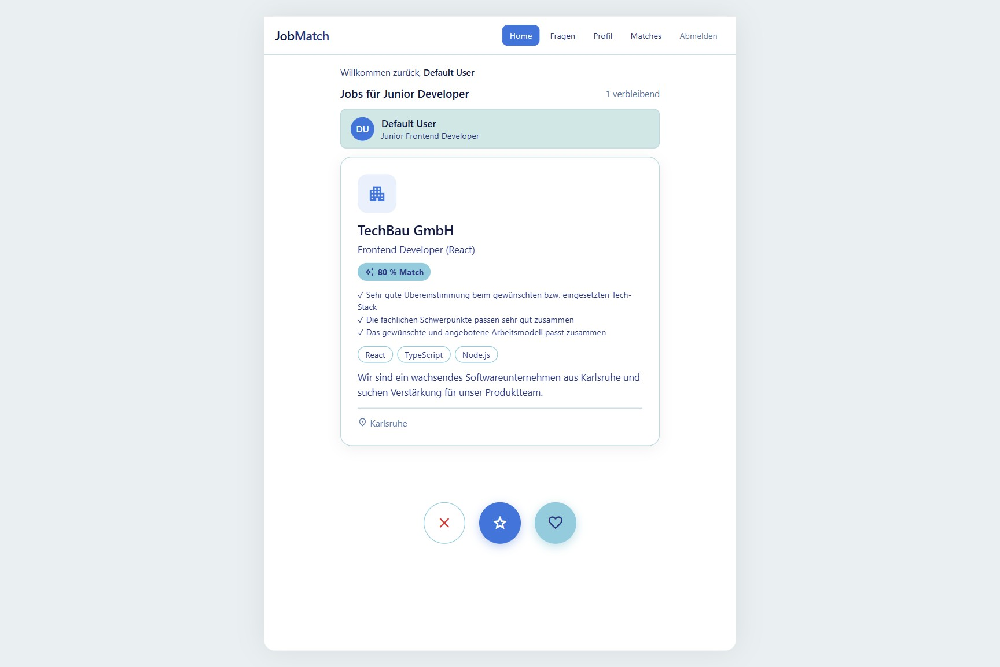
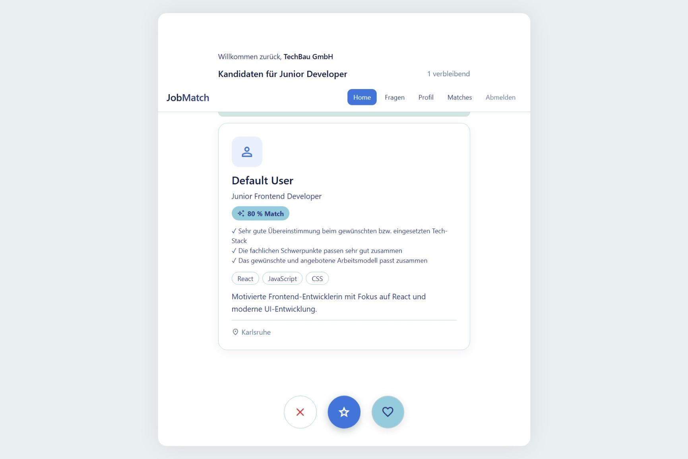
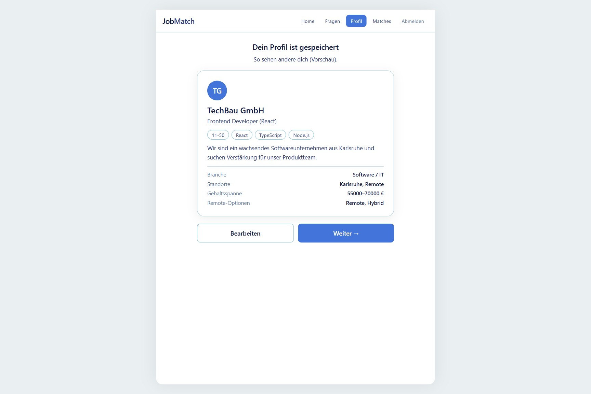
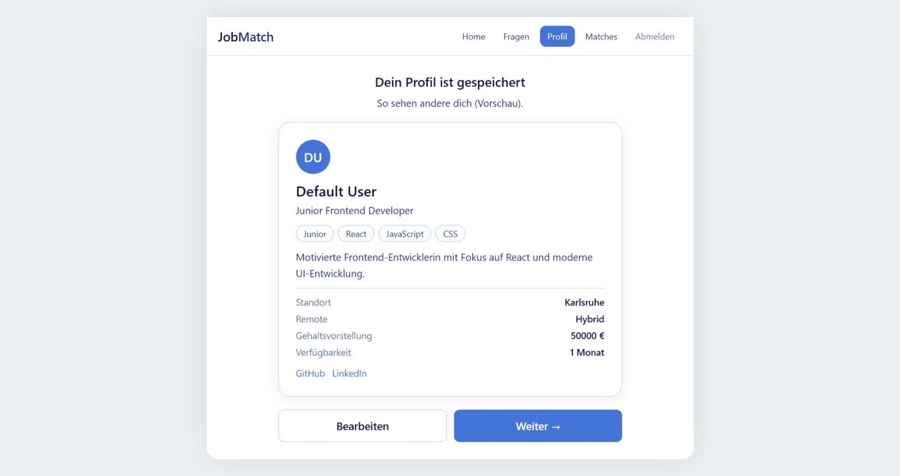
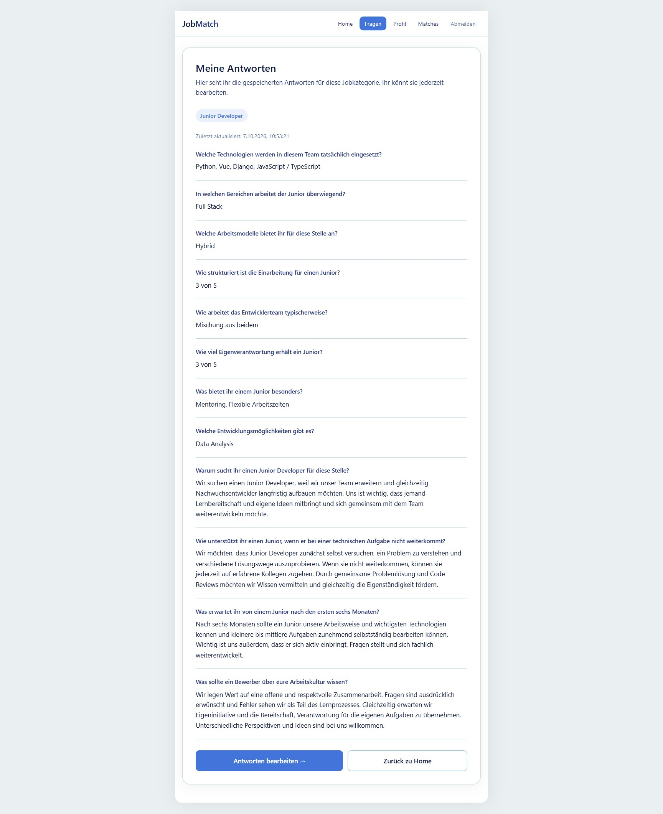
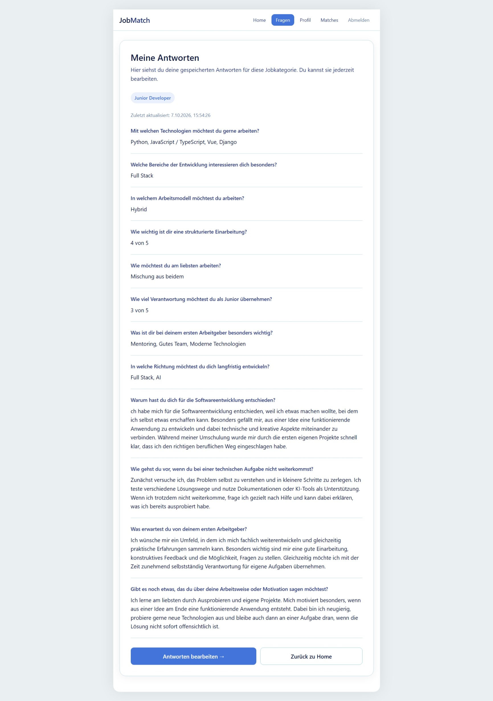
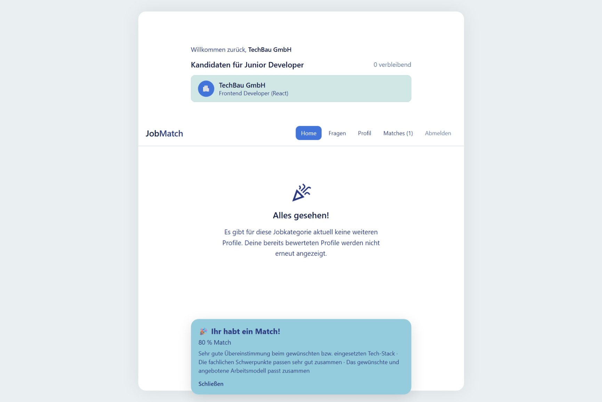
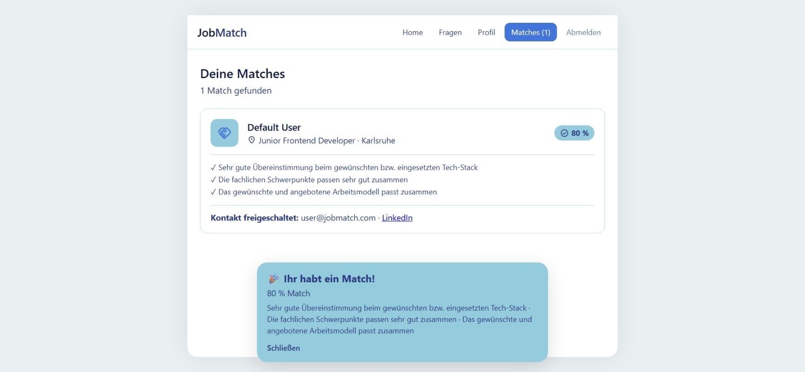

# JobMatch

## Screenshots

<p align="center">
  
  
</p>

<p align="center">
  
  
</p>

<p align="center">
  
  
</p>

<p align="center">
  
  
</p>

JobMatch is a two-sided job matching platform that connects job seekers and companies based on their profiles, skills, preferences, and requirements.

This project is open source and actively developed. Issues, pull requests, and ideas are welcome, regardless of experience level.

## Concept

Instead of having to apply to each company individually, job seekers create a reusable profile containing the information typically required during the application process.

Companies also create their own profiles and define their requirements, expectations, and working conditions.

In addition, both sides complete a job-specific questionnaire. The answers provide a common basis for matching and make the requirements and expectations of both sides easier to compare.

The platform compares both sides and identifies suitable matches.

```text
Job Seeker Profile
     │
     ▼
  Questionnaire ───────┐
                       │
                       ▼
                 Matching Engine
                       ▲
                       │
  Questionnaire ───────┘
     ▲
     │
Company Profile
     │
     ▼
     Match
```

The goal is not only to provide a matching score, but also to make it understandable why two profiles are a good fit.

A match is created when both sides express interest. The interaction does not have to rely on a swipe-based principle. Swiping is simply one possible user interface for expressing interest.

## Features

* Account system with two roles: Admin (companies) and User (job seekers)
* Registration and login with JWT authentication
* Short-lived access tokens and rotating refresh tokens using HttpOnly cookies
* Detection of reuse of already consumed refresh tokens
* Detailed, editable profiles
* Information about skills, experience level, salary expectations, remote preferences, availability, links, and other details
* Job-specific questionnaires for job seekers and companies
* First supported job category: **Junior Developer**
* Complete overview of previously answered questions
* Ability to edit answers afterwards
* Matching engine for comparing answers from both sides
* Weighted matching criteria
* Transparent match score with explanations
* Mutual interest model
* A real match is only created when both sides express interest
* Swipe interface for browsing suitable profiles
* Match list with contact unlocked after mutual interest
* Responsive layout for desktop, tablet, and mobile devices

## Questionnaire and Matching

JobMatch does not rely exclusively on traditional profile data for matching.

Job seekers and companies complete their own questionnaire for the selected job category. This makes it possible to compare not only technical skills, but also expectations regarding collaboration.

For the **Junior Developer** category, the following areas are taken into account, among others:

* Technologies and technical interests
* Development areas
* Work model
* Teamwork
* Personal responsibility and autonomy
* Onboarding and mentoring
* Code reviews
* Working style
* Training and development opportunities
* Offered projects and tasks
* Expectations towards job seekers and employers

The answers are compared and converted into a match score.

Different criteria can be weighted so that important aspects have a stronger influence on the matching result.

In addition, reasons for the match are displayed so that the result remains understandable.

Personal questions provide additional information about the respective side and are not directly included in the numerical match score.

### Answer Overview

After completing the questionnaire, users can view their answers at any time in a dedicated overview.

The overview displays:

* All questions of the selected questionnaire
* The corresponding saved answer
* Multiple-choice selections
* Scale values
* The option to edit the questionnaire again

This keeps it transparent which information is currently stored and used for matching.

## Application Flow

The current application flow is:

```text
Registration / Login
        │
        ▼
     Profile
        │
        ▼
 Select Job Category
        │
        ▼
 Complete Questionnaire
        │
        ▼
   Answer Overview
        │
        ├── Edit Answers
        │
        ▼
 Matching Profiles
        │
        ▼
   Show Interest
        │
        ▼
  Mutual Interest
        │
        ▼
       Match
```

## Technology Stack

### Frontend

* React
* Vite
* react-tinder-card
* Material Symbols (Google Fonts)

### Backend

* ASP.NET Core Web API on .NET 10
* Controller-based architecture
* Entity Framework Core
* SQLite
* ASP.NET Core Identity
* JWT access tokens
* Rotating refresh tokens
* HttpOnly cookies
* Swagger / OpenAPI

## Design

### Color Palette

The user interface uses a consistent color palette. The following colors correspond to the CSS variables used in the frontend:

| Preview | CSS Variable | Color Code | Usage |
|:---:|---|:---:|---|
| 🔵 | `--color-accent` | `#4274D9` | Primary accent for buttons, links, and active states |
| 🟦 | `--color-accent-hover` | `#293681` | Hover state of primary buttons |
| ⬜ | `--color-accent-bg` | `#EAF0FC` | Hover and selected states |
| 🩵 | `--color-highlight` | `#95CCDD` | Background for tags and badges |
| 🟦 | `--color-highlight-text` | `#293681` | Text on tags and badges |
| 🩶 | `--color-surface-subtle` | `#D0E7E6` | Subtle surfaces, containers, and filters |
| 🩶 | `--color-chip-bg` | `#D0E7E6` | Chip and filter background |
| ⬜ | `--color-bg` | `#EAEFF2` | Page background |
| ⬜ | `--color-surface` | `#FFFFFF` | Cards, containers, and other surfaces |
| ◻️ | `--color-border` | `#BCD9DF` | Borders and subtle separators |
| 🩵 | `--color-border-strong` | `#95CCDD` | More prominent separators |
| 🔷 | `--color-text-primary` | `#121A42` | Primary text |
| 🟦 | `--color-text-secondary` | `#293681` | Secondary text, labels, and subheadings |
| 🔹 | `--color-text-muted` | `#5C77A5` | Muted text and supporting information |
| 🟦 | `--color-success` | `#293681` | Success messages and positive status indicators |
| 🟩 | `--color-success-bg` | `#E2F4EB` | Background for success messages |
| 🔴 | `--color-danger` | `#D93838` | Error and warning states |
| 🟥 | `--color-danger-bg` | `#FCE8E8` | Background for error and warning messages |

The core colors of the design are dark blue (`#293681`), blue (`#4274D9`), light ice blue (`#95CCDD`), and a very light blue-green tone (`#D0E7E6`). Success and error colors are used separately for status states.

Interactive states such as hover effects and selected items use dedicated variants (e.g. `--color-accent-hover`, `--color-accent-bg`) derived from this base palette instead of introducing unrelated colors.

## Project Structure

```text
JobMatch/
├── backend/
│   ├── Program.cs
│   ├── Data/
│   │   └── AppDbContext, DbSeeder, Demo Profile Data
│   ├── Entities/
│   │   └── Identity Entities, Profile, QuestionnaireResponse, Interest
│   ├── Auth/
│   │   └── ITokenService, TokenService, JwtSettings
│   ├── Models/
│   │   └── Authentication and Questionnaire DTOs
│   ├── Services/
│   │   └── Question Catalog and Matching Engine
│   └── Controller/
│       └── Authentication, Profile, Questionnaire and Matching APIs
│
└── frontend/
    └── src/
        ├── components/
        │   └── Navbar, SwipeCard, TagInput, ToggleGroup, Icon, ...
        ├── pages/
        │   └── AuthForm, ProfileForm, ProfileCard, JobTypeSelect,
        │       QuestionnairePage, QuestionnaireOverview, SwipeScreen, Matches
        ├── hooks/
        │   └── useBreakpoint, useSwipe
        ├── styles/
        │   └── global.css (color palette and base styles)
        ├── data/
        │   └── Mock data for job offers and candidates
        ├── api.js
        │   └── API communication and authentication
        └── App.jsx
```

## Getting Started

### Prerequisites

* .NET SDK 10
* Node.js 20 or newer
* npm

### Using the Cloned Repository

If you have cloned this repository, you can go directly to [Running the Application](#running-the-application).

All required packages are already defined in `backend.csproj` and `frontend/package.json`.

### Creating the Projects from Scratch

Only relevant if you are setting up a project like this from scratch instead of cloning this repository.

#### Backend

```bash
dotnet new webapi -controllers -n backend
cd backend
```

The `-controllers` flag is important. Without it, .NET creates a Minimal API project without a `Controllers/` folder by default.

#### Frontend

```bash
npm create vite@latest frontend -- --template react
cd frontend
```

## Installing Packages

### Backend

```bash
cd backend
dotnet add package Microsoft.AspNetCore.Authentication.JwtBearer
dotnet add package Microsoft.AspNetCore.Identity.EntityFrameworkCore
dotnet add package Microsoft.EntityFrameworkCore.Sqlite
dotnet add package Microsoft.EntityFrameworkCore.Design
dotnet add package Swashbuckle.AspNetCore
```

### Frontend

```bash
cd frontend
npm install
npm install react-tinder-card @react-spring/web --legacy-peer-deps
```

`react-tinder-card` handles the swipe gesture and requires `@react-spring/web` for the animation.

The `--legacy-peer-deps` flag is required because the declared peer dependency of `react-tinder-card` does not yet include React 19.

## Icons

Material Symbols are loaded through Google Fonts and are not installed as an npm package.

Add the following to `index.html`:

```html
<link rel="preconnect" href="https://fonts.googleapis.com" />
<link rel="preconnect" href="https://fonts.gstatic.com" crossorigin />
<link
  href="https://fonts.googleapis.com/css2?family=Material+Symbols+Outlined:opsz,wght,FILL,GRAD@20..48,100..700,0..1,-50..200"
  rel="stylesheet"
/>
```

## Configuration

ASP.NET Core User Secrets can be used for the JWT key:

```bash
cd backend
dotnet user-secrets init
dotnet user-secrets set "Jwt:Key" "<a long random value>"
```

The JWT key should not be stored directly in the repository.

## Running the Application

### Backend

```bash
cd backend
dotnet run
```

The Swagger user interface is available at `/swagger` once the API is running.

On the first start, two accounts with pre-filled example profiles are created:

* **Company account:** `admin@jobmatch.com` / `Admin123!`
* **Job seeker account:** `user@jobmatch.com` / `User123!`

### Frontend

```bash
cd frontend
npm run dev
```

By default, the frontend expects the API at:

```text
http://localhost:5254
```

This value can be overridden using the `VITE_API_URL` environment variable.

Example:

```text
VITE_API_URL=http://localhost:5254
```

## Contributing

JobMatch is actively developed and open to contributions from anyone interested.

Whether it is bug fixing, a new feature, improved test coverage, or documentation improvements, pull requests are welcome.

If you are not sure where to start, open an issue and describe what you would like to work on, or ask a question.

### Pull Request

1. Fork the repository
2. Create a branch for your changes
3. Implement and test your changes
4. Open a pull request with a description of the changes and their motivation

## Roadmap

* Additional job categories and dedicated question sets
* Extending the matching score with additional profile criteria such as experience, salary, and location
* More detailed match explanations and category-specific weighting
* Extending the contact and application process after a match
* Real job management with multiple open positions per company
* Extending the matching logic with additional profile and preference data

## License

This project is licensed under the MIT License.

For more information, see the `LICENSE` file.
